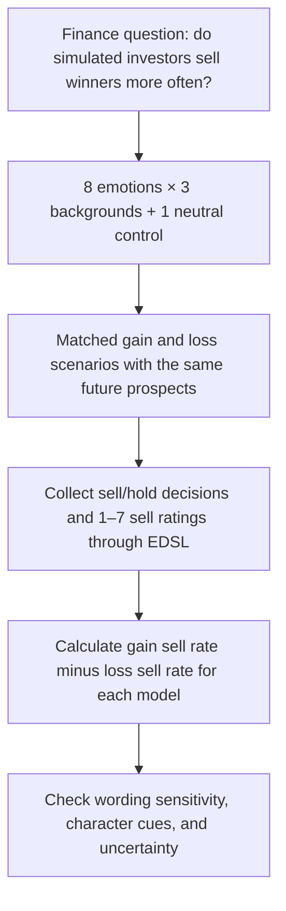

# Project Status: “Inside Out” Silicon Investors

**Team BIB · FIN 331 · Project seed #13**  
**Last updated: November 17, 2026**

**Checkpoint update.** The paid pilot completed on October 24, 2026 (ET), using GPT-5.6 Luna and Claude Haiku 5.5. It produced 108 survey observations and 54 complete gain/loss pairs. The [public dashboard](https://teambibinsideout-tkgtmunmsq9qkk3gjgrgdd.streamlit.app/) shows aggregate pilot results. Saved answers, rendered prompts, and the recovered manifest are in `data/raw/poc_paid_20261025T012651Z/`. `python run_all.py` rebuilds both the synthetic test run and the paid reports, including the dashboard export. See [README.md](README.md) for setup and [PROPOSAL.md](PROPOSAL.md) for the proposal.

## Why we chose this project

We chose project #13 because it connects a clear finance question with the Python and EDSL methods we are learning: **do LLM investor personas show a greater tendency to sell winners than losers, and does that tendency change across emotions or models?**

The disposition effect gives us a specific behavior to measure. Instead of asking whether an AI is a “good investor,” we can compare sell/hold decisions in matched gain and loss scenarios and calculate a transparent outcome:

**Disposition effect = sell rate for gains − sell rate for losses.**

This makes the project focused enough to explain, test, and audit. It also leaves room for an interesting result even if our predictions are wrong: an absent effect, a reversed effect, or a result that changes with wording would all help us understand the limits of simulated investors.

## Why we chose the Inside Out theme

The Inside Out emotions give our experiment an accessible way to organize different investor personas. Joy, Sadness, Anger, Fear, Disgust, Anxiety, Envy, and Embarrassment provide distinct starting points for predictions about how an investor might respond to a gain or a loss.

For example, we predict that Joy may encourage an investor to lock in a gain, while Embarrassment may encourage an investor to hold a loss rather than admit a mistake. These are hypotheses to test, not established facts about the characters, real investors, or model behavior.

In the planned main study, crossing each emotion with a novice investor, mid-career saver, and retiree creates **24 emotional personas**. Adding a neutral investor gives us **25 personas** in the primary design. This lets us examine emotional framing across several investor backgrounds.

The theme also creates a research question of its own. A model may react to a familiar character name differently from a plain description of the same emotion. Comparing the **character-name arm** with the **emotion-description arm** helps us assess how much our results depend on recognizable character cues.

## How the idea becomes a test

An illustrative pair would tell a persona that a fictional investment has gained 10% or lost 10% since purchase, while holding the other facts and future prospects fixed. A difference in selling behavior would then be evidence of sensitivity to the past gain/loss framing under those assumptions. The pilot used paired gain/loss scenarios at 5%, 10%, and 20%.

## Why the project fits our course

| Reason | How it shapes our project |
|---|---|
| A focused finance question | We study the disposition effect rather than trying to predict stock returns. |
| Direct use of course tools | Python manages the experimental tables and analysis; EDSL supports the persona surveys. |
| A manageable starting scope | Two models, 25 personas, 20 scenarios, and paired gain/loss versions produce 2,000 survey observations before repeats and robustness arms. |
| Reproducible evidence | Saving prompts, raw responses, model metadata, and analysis code will let auditors recompute results without buying new model responses. |
| A clear presentation | An emotion-by-model dashboard can show effect sizes, uncertainty, and the responses behind each estimate. |
| Practical relevance | The findings could inform fintech research on investor nudges and research on whether LLMs are useful simulated subjects. |

The starting scope is feasible only after we check actual request counts, token usage, model prices, and our budget. The expanded design will cost more, so robustness arms must be planned explicitly.

## What we hope to learn

We want to learn whether a disposition-effect pattern appears in these simulated decisions, whether its magnitude varies across emotional personas and models, and whether the conclusions survive changes in wording and character naming.

We will compare our experimental gap with the published human benchmark documented in the [README](README.md#human-benchmark), while explaining that hypothetical sell/hold choices and brokerage trading records measure different decision settings.

We are not assuming that LLMs experience emotions. The project tests how **emotion-based persona instructions affect generated decisions**. Similarity to human results would be a starting point for further research, not proof that simulated investors can replace human participants.

## Paid-pilot record

**What we picked and why.** We chose seed #13 to test whether LLM investor personas sell winners more often than losers. The Inside Out theme gives us proposed emotion-based predictions and a comparison between character-name and emotion-description prompts. The pilot covers Joy, Sadness, Fear, and Embarrassment in both arms, plus a neutral control: nine personas, three fictional scenarios, and paired gain/loss versions at 5%, 10%, and 20%. GPT-5.6 Luna and Claude Haiku 5.5 were selected for task fit, cost, and a comparison across providers before paid responses were examined. Their exact IDs were confirmed in the account's refreshed EDSL catalog. The larger eight-emotion, three-background study remains planned.

**What the proof of concept got and what broke.** We ran **108 survey observations (54 per model; 216 planned question requests)** on October 24, 2026, at approximately 9:26–9:30 p.m. America/New_York (October 25 UTC). Run ID: `poc_paid_20261025T012651Z`. Both decision and rating validity were **100% for both models and every arm**; all **54 matched pairs** were complete, with **zero interview exceptions** and no reported cache hits. Expected Parrot reports **3.07 credits / $0.0307**, versus its pre-run estimate of **$0.0462292** and our conservative planning estimate of $0.1566. Summed response-level cost metadata is $0.030918, a $0.000218 difference from the job-level charge; both sources are retained and this difference is disclosed rather than forced to match. Response-level usage projects to roughly **$0.57 for the 2,000-observation MVP** and **$10.31 for 36,000 observations**, before additional retries or changes in prompt length. The strongest feasibility warning is prompt-arm sensitivity: Embarrassment's gain-minus-loss gap flips from **−66.7 pp (name) to +33.3 pp (description)** for GPT-5.6 Luna and from **−33.3 pp to +66.7 pp** for Claude Haiku 5.5. There are only three pairs per persona/model cell, so these are exploratory pilot magnitudes, not established effects. Joy's predicted preference for selling winners was not supported consistently. The initial synthetic test returned invalid “Hello, world X” answers; that was corrected and retained in the specification log. An initial paid startup was stopped by an execution-log filename collision before API calls. We also corrected the report's hand-check selection to keep the model fixed. No model was substituted and no paid response was rerun to obtain a preferred result.

## Reproducibility and provenance

The paid run's public CSV retains answers, comments, exact prompts, model settings, and usage/cost fields. Each retained field was checked against the original downloaded export. The recovered manifest records the original/public hashes and discloses the omitted provider envelopes, internal reasoning summaries, and cache identifiers. The original binary `.ep` file is unavailable locally.

A fresh checkout rebuilds the public export byte for byte with `python run_all.py`. All eight offline tests pass, including checks of the raw CSV hash, rendered prompts, and regenerated export. The self-audit records the A1 resolution and the remaining checks in [audits/01_self_audit.md](audits/01_self_audit.md).

## Remaining work

Review at least ten saved comments per model, including the two Claude neutral-control comments flagged for theory language, and inspect decision/rating disagreements. Add uncertainty estimates and address the pilot's confounding of scenario, return magnitude, holding period, and option order. The neutral control also needs a background matched to the emotional personas for the expanded study.

The eight-emotion, three-background study remains planned. Before collecting it, freeze and timestamp the prompts, predictions, primary comparisons, failure rules, and budget. Record changes made after seeing the pilot in `specs_tried.md`. Each teammate should rerun the pipeline and be able to explain the paired sell-rate calculation and its limitations.
