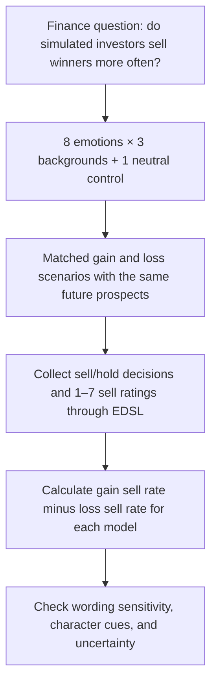

# Project Status: “Inside Out” Silicon Investors

**Team BIB · FIN 331 · Project seed #13**  
**Last updated: October 24, 2026**

**Checkpoint update:** the pilot tables and EDSL scripts now exist, and a corrected synthetic dry run passed with 54 observations and 27 complete pairs. GPT-5.6 Luna and Claude Haiku 5.5 are selected for the paid pilot. No paid results have been collected; the existing Expected Parrot setup must still be located. See [STATUS_checkpoint1.md](STATUS_checkpoint1.md) for executed evidence and [POC_README.md](POC_README.md) for the run procedure.

## Why we chose this project

We chose project #13 because it connects a clear finance question with the Python and EDSL methods we are learning: **do LLM investor personas show a greater tendency to sell winners than losers, and does that tendency change across emotions or models?**

The disposition effect gives us a specific behavior to measure. Instead of asking whether an AI is a “good investor,” we can compare sell/hold decisions in matched gain and loss scenarios and calculate a transparent outcome:

**Disposition effect = sell rate for gains − sell rate for losses.**

This makes the project focused enough to explain, test, and audit. It also leaves room for an interesting result even if our predictions are wrong: an absent effect, a reversed effect, or a result that changes with wording would all help us understand the limits of simulated investors.

## Why we chose the Inside Out theme

The Inside Out emotions give our experiment an accessible way to organize different investor personas. Joy, Sadness, Anger, Fear, Disgust, Anxiety, Envy, and Embarrassment provide distinct starting points for predictions about how an investor might respond to a gain or a loss.

For example, we predict that Joy may encourage an investor to lock in a gain, while Embarrassment may encourage an investor to hold a loss rather than admit a mistake. These are hypotheses to test, not established facts about the characters, real investors, or model behavior.

Crossing each emotion with a novice investor, mid-career saver, and retiree creates **24 emotional personas**. Adding a neutral investor gives us **25 personas** in the primary design. This lets us examine emotional framing across several investor backgrounds.

The theme also creates a research question of its own. A model may react to a familiar character name differently from a plain description of the same emotion. Comparing the **character-name arm** with the **emotion-description arm** helps us assess how much our results depend on recognizable character cues.

## How the idea becomes a test

An illustrative pair would tell a persona that a fictional investment has gained 10% or lost 10% since purchase, while holding the other facts and future prospects fixed. A difference in selling behavior would then be evidence of sensitivity to the past gain/loss framing under those assumptions. We have not collected responses to this example.

## Why the project fits our course

| Reason | How it shapes our project |
|---|---|
| A focused finance question | We study the disposition effect rather than trying to predict stock returns. |
| Direct use of course tools | Python manages the experimental tables and analysis; EDSL supports the persona surveys. |
| A manageable starting scope | Two models, 25 personas, 20 scenarios, and paired gain/loss versions produce 2,000 survey observations before repeats and robustness arms. |
| Reproducible evidence | Saving prompts, raw responses, model metadata, and analysis code will let auditors recompute results without buying new model responses. |
| A clear presentation | An emotion-by-model dashboard can show effect sizes, uncertainty, and the responses behind each estimate. |
| Practical relevance | The findings could inform fintech research on investor nudges and research on whether LLMs are useful simulated subjects. |

The starting scope is feasible only after we check actual request counts, token usage, model prices, and our budget. The expanded design will cost more, so robustness arms must be planned explicitly.

## What we hope to learn

We want to learn whether a disposition-effect pattern appears in these simulated decisions, whether its magnitude varies across emotional personas and models, and whether the conclusions survive changes in wording and character naming.

We will compare our experimental gap with the published human benchmark documented in the [README](README.md#human-benchmark), while explaining that hypothetical sell/hold choices and brokerage trading records measure different decision settings.

We are not assuming that LLMs experience emotions. The project tests how **emotion-based persona instructions affect generated decisions**. Similarity to human results would be a starting point for further research, not proof that simulated investors can replace human participants.

## Current status

This status reflects the materials currently in this repository.

| Item | Status |
|---|---|
| Select project seed #13 and Inside Out theme | Complete |
| Document the research question, proposed predictions, and experimental design | Complete in the README |
| Outline the EDSL pipeline, dataset contract, and audit requirements | Complete as a plan |
| Build persona/scenario tables and finalize prompt wording | Pilot tables implemented; main-study tables pending |
| Select exact models, estimate costs, and set a spending cap | Two models selected; planning estimate documented; account estimate and budget review pending |
| Implement and validate survey collection and offline analysis | Pilot scripts implemented; synthetic validation passed; live validation pending |
| Run a labeled pilot and log any design changes | Pending |
| Freeze and timestamp the main-run specifications | Pending |
| Collect main-run responses and analyze results | Pending |
| Build and verify the dashboard | Planned |

**No experimental findings are reported in the repository at this stage.** A pilot pipeline has been tested with synthetic answers; the full study and dashboard remain planned.

## Immediate next steps

1. Locate the existing Expected Parrot setup and verify account access to both selected models.
2. Review the account-based estimate and budget, then run the paid pilot.
3. Inspect raw responses and billing, update STATUS_checkpoint1.md with measured results, and add the artifacts to the draft PR.
4. Expand the pilot tables to the main design and log all changes in `specs_tried.md`.
5. Freeze the main-study design and predictions before collecting main-run responses.

The full design, outcome definitions, budget calculations, and threats to validity are documented in [README.md](README.md).
